<picture>
  <source media="(prefers-color-scheme: dark)" srcset="assets/hero-dark.svg">
  
</picture>

**Dev full-stack em formação e designer há mais de 5 anos.** Uno o olhar de design à graduação em Análise e Desenvolvimento de Sistemas para criar interfaces claras, acessíveis e bem implementadas.

[Ver meu currículo online](https://meu-curriculo-psi.vercel.app) · [Falar comigo no LinkedIn](https://www.linkedin.com/in/cleberfranca12) · [Enviar um e-mail](mailto:cleber.francaa12@gmail.com)

<picture>
  <source media="(prefers-color-scheme: dark)" srcset="assets/divider-dark.svg">
  
</picture>

## Habilidades & Tecnologias

<picture>
  <source media="(prefers-color-scheme: dark)" srcset="assets/skills-dark.svg">
  
</picture>

**Soft skills:** resolução de problemas · trabalho em equipe · comunicação clara

## Trajetória & Formação

<picture>
  <source media="(prefers-color-scheme: dark)" srcset="assets/timeline-dark.svg">
  
</picture>

- **Design**: mais de 5 anos de experiência
- **Análise e Desenvolvimento de Sistemas**, Faculdade Uniateneu (2026, 1º de 5 semestres)
- **Formação Fullstack, Geração Tech**, Digital College (2026)
- **Meta**: primeira oportunidade como desenvolvedor

<picture>
  <source media="(prefers-color-scheme: dark)" srcset="assets/divider-dark.svg">
  
</picture>

## Projetos

<a href="https://meu-curriculo-psi.vercel.app">
  <picture>
    <source media="(prefers-color-scheme: dark)" srcset="assets/projeto-curriculo-dark.svg">
    
  </picture>
</a>

[Abrir o currículo interativo](https://meu-curriculo-psi.vercel.app) · [Ver o código](https://github.com/Clbrfrancaa/meu-curriculo)

- **[FIREWATCHER](https://github.com/1kaliel/astro-boys)**: dashboard de focos de calor da equipe Astro Boys no NASA Space Apps 2026. Cuidei do front-end e do design system do dashboard. [Abrir a demo](https://astro-dashboard-301238386836.us-central1.run.app)
- **[DripStore: front-end](https://github.com/Clbrfrancaa/dripStore-final)** e **[back-end](https://github.com/Clbrfrancaa/backend-dripStore)**: e-commerce em React e um CRUD em Node.js, projetos finais do Geração Tech
- **[Landing page com Bootstrap](https://github.com/Clbrfrancaa/landing_page_2)**: página responsiva em HTML e Bootstrap

## Vamos conversar?

Estou disponível para novas oportunidades, projetos práticos e troca de experiências na área de tecnologia.

[cleber.francaa12@gmail.com](mailto:cleber.francaa12@gmail.com) · [LinkedIn: /in/cleberfranca12](https://www.linkedin.com/in/cleberfranca12)
